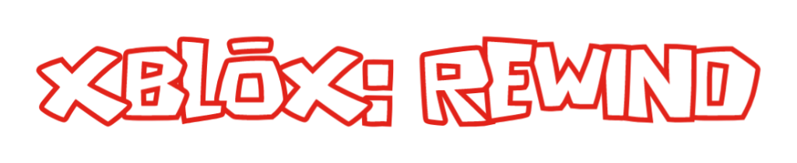
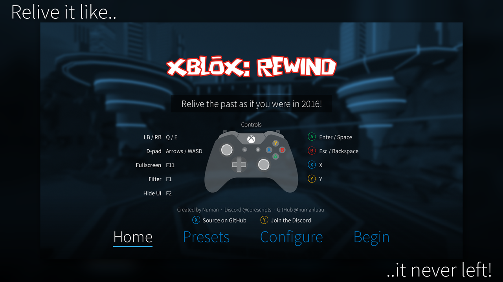
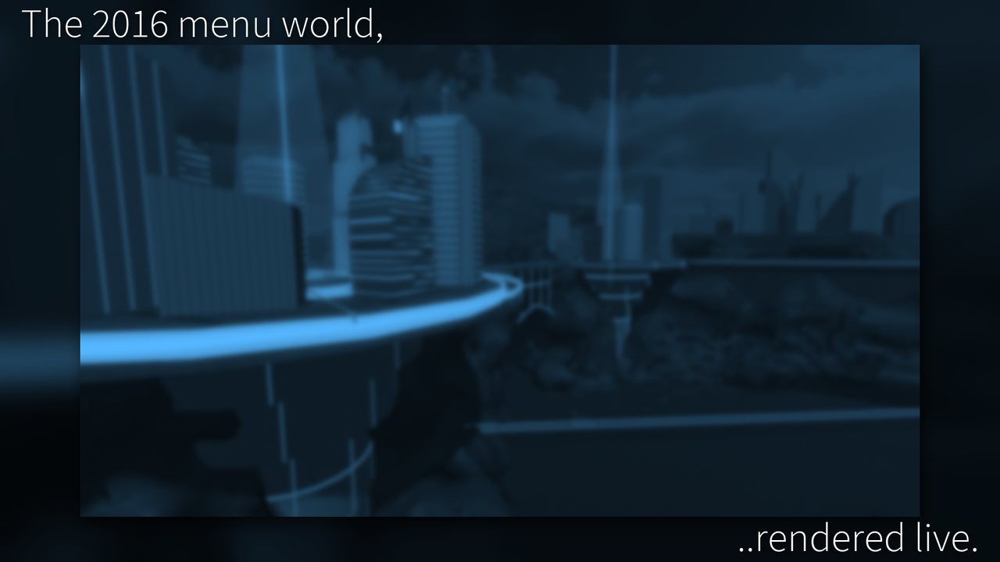
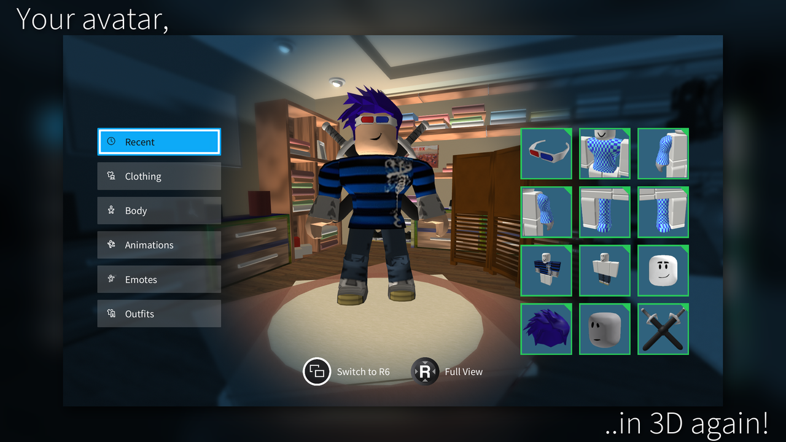
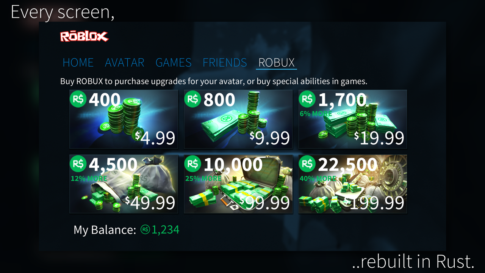
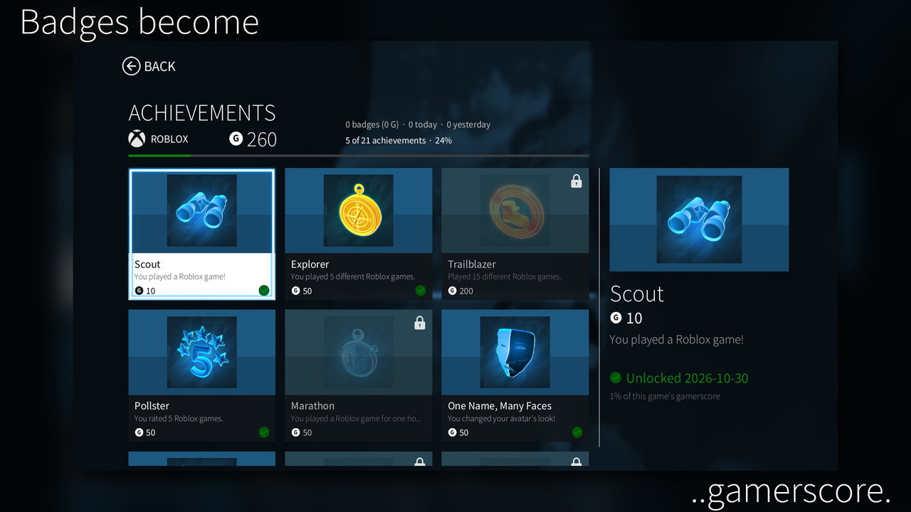
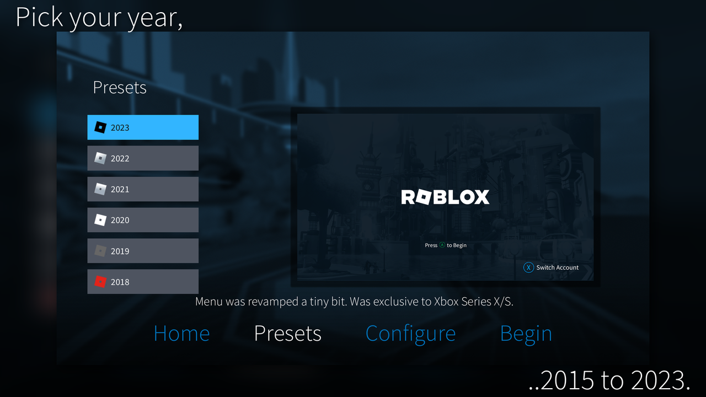

<div align="center">



**Relive the past as if you were in 2016!**

A Rust recreation of the Roblox UI for Xbox consoles, with extra features that replace the need for a browser or the Roblox app home (besides buying avatar items).

[](https://github.com/NumanLUAU/XBLOX-REWIND/actions/workflows/build.yml)
[](https://github.com/NumanLUAU/XBLOX-REWIND/releases/latest)
[](https://discord.gg/F7Nzshp9VT)


[Download](https://github.com/NumanLUAU/XBLOX-REWIND/releases/latest) ·
[Features](#features) ·
[Controls](#controls) ·
[Building](#building-from-source) ·
[Discord](https://discord.gg/F7Nzshp9VT)

</div>

---



## What is this?

Back in 2016, Roblox on the Xbox One had its own menu: big tiles, a slow-moving 3D city behind
everything, the blue overlay, the sounds. It was replaced years ago, and the Lua scripts that drove
it were leaked and made public. **XBLOX: REWIND** rebuilds that menu as a native Windows app, screen by screen,
from those scripts, and hooks it up to your real Roblox account.

It is not a skin over a web page. The menu world, the avatar and every screen are drawn by its own
renderer, written in Rust on top of `wgpu`. When you press Play, the game opens in the normal
Roblox player.

> [!NOTE]
> XBLOX: REWIND is a fan project. It is not made by, affiliated with or endorsed by Roblox
> Corporation or Microsoft.

## Screenshots

<table>
  <tr>
    <td></td>
    <td></td>
  </tr>
  <tr>
    <td></td>
    <td></td>
  </tr>
  <tr>
    <td colspan="2"></td>
  </tr>
</table>

## Features

### The menu

- **Home, Avatar, Games, Friends and ROBUX tabs**, laid out like the console app, with your
  favorites, recently played and featured games, and friend activity.
- **Search** with the on-screen Xbox keyboard, results in a carousel.
- **Game pages** with ratings, screenshots, voting, favorites and server joining.
- **Friends** with live presence: in game, in Studio, on the website, offline.
- **The 3D menu world**: the City, Space and Volcano flythrough from the original app, rendered
  live with Roblox-style lighting, skyboxes, terrain, unions and meshes.

### The avatar editor

- The 2018 console editor rebuilt in 3D: categories, the item grid, skin tones, scale sliders,
  the emote wheel, outfits and bundles.
- **Changes show instantly.** Wearing an item, switching R6/R15 or changing a scale updates the
  3D avatar straight away while Roblox saves it in the background. If Roblox refuses, it switches back.
- Body scaling matches Studio's own avatar builder, including Body Type and Proportions.
- UGC bodies, dynamic heads, layered clothing and your saved accessory adjustments.
- Animation packs and emotes play on the avatar, and it eases back to idle when they end.

### Extras the console never had

- **Parties over IP.** Host a party on a port, friends join with your address, and everyone can
  follow the host into the same server.
- **Achievements and gamerscore.** The 11 original Xbox achievements, plus your Roblox badges:
  every badge is worth gamerscore by how rare it is, milestones unlock achievements, and badges
  you earn in a game pop up when you come back.
- **Presets and settings** for every year from 2015 to 2023: themes, logos, loading screens,
  lighting, Robux icons, button glyphs and more.
- **Fast Boot** to go straight into the menu.

### What it will not do

| | |
|---|---|
| Buy Robux or avatar items | Purchases show *"This feature is not available"*. The ROBUX store only adds pretend Robux for the session. |
| Touch your real Robux balance | Read-only. |
| Send your login anywhere but Roblox | Your `.ROBLOSECURITY` cookie is only ever sent to `roblox.com` (or the site in `config.ini`) and is stored encrypted with Windows DPAPI. |

## Getting started

1. Grab `XBLOX-REWIND-windows-x64.zip` from the [latest release](https://github.com/NumanLUAU/XBLOX-REWIND/releases/latest).
2. Unzip it anywhere and run **`XbloxRewind.exe`**.
3. Pick your settings in the hub (or just press **Begin**), then sign in.

### Signing in

Sign-in uses Roblox's **Quick Login**: the launcher shows a six-character code and a QR code.
On a phone or computer that is already signed in, open `roblox.com/crossdevicelogin` (or scan
the QR code), enter the code and approve it. The launcher shows which account is asking while you
approve, then signs straight in.

Prefer the old way? Press <kbd>Y</kbd> on the sign-in screen to paste a `.ROBLOSECURITY` cookie instead.

> [!TIP]
> Turn on **Fast Boot** when you press Begin to skip the hub on later launches. You can turn it
> off again from **Settings** with <kbd>X</kbd>.

<details>
<summary><b>Requirements</b></summary>

- Windows 10 or 11 (64-bit)
- A GPU with DirectX 12 or Vulkan support
- The Roblox player installed, to actually join games

</details>

### Parties over the internet

Open **Friends** and press <kbd>X</kbd> to start a party. It listens on port `27500`.

- **Same network or port forwarded:** others join with your IP and port, like `203.0.113.7:27500`.
- **playit.gg:** make a **TCP** tunnel to `127.0.0.1:27500` and share the address playit gives you.
  Joining accepts it however it is pasted: `name.ply.gg:12345`, a full `https://` link, or a
  `joinmc.link` address without a port (the port is looked up from its DNS record).

When the host joins a game, everyone in the party follows them into the same server.

### config.ini

`config.ini` is created next to `XbloxRewind.exe` on first launch. It picks the site the launcher
talks to:

```ini
[server]
domain = roblox.com
```

Set `domain` to a Roblox revival's domain to point every web request (and your sign-in) there instead.

## Controls

A controller works out of the box. Keyboard and mouse work too:

| Action | Controller | Keyboard |
|---|---|---|
| Select | <kbd>A</kbd> | <kbd>Enter</kbd> / <kbd>Space</kbd> |
| Back | <kbd>B</kbd> | <kbd>Esc</kbd> / <kbd>Backspace</kbd> |
| Screen actions | <kbd>X</kbd> / <kbd>Y</kbd> | <kbd>X</kbd> / <kbd>Y</kbd> |
| Switch tabs | <kbd>LB</kbd> / <kbd>RB</kbd> | <kbd>Q</kbd> / <kbd>E</kbd> |
| Move | D-pad / left stick | Arrows / <kbd>W</kbd><kbd>A</kbd><kbd>S</kbd><kbd>D</kbd> |
| View button (editor) | <kbd>View</kbd> | <kbd>V</kbd> |
| Right stick (editor) | <kbd>RS</kbd> | <kbd>R</kbd> |
| Fullscreen | | <kbd>F11</kbd> |
| Background filter | | <kbd>F1</kbd> |
| Hide the UI | | <kbd>F2</kbd> |

## Building from source

You need [Rust](https://rustup.rs) (stable) on Windows.

```bash
git clone https://github.com/NumanLUAU/XBLOX-REWIND.git
cd XBLOX-REWIND/launcher
cargo build --release
```

The executable ends up in `launcher/target/release/XbloxRewind.exe`. It finds its content by
walking up from where it runs, so it works straight from there. `build.bat` builds at low priority
and copies the EXE to the repository root.

Every push is built by GitHub Actions, and tagged versions (`v*`) are published as releases.

<details>
<summary><b>Project layout</b></summary>

```
XBLOX-REWIND/
├─ launcher/
│  ├─ src/            the app (Rust): renderer, menu screens, avatar, parties, achievements
│  ├─ src/shaders/    WGSL shaders for the scene, sky, post-processing and UI
│  ├─ assets/         icons, glyphs, sounds, rigs and bundled place textures
│  └─ docs/           README screenshots
├─ genericcontent/    the Roblox client content the menu uses (fonts, textures, sounds)
├─ xboxassets/        the Xbox app's own textures and sounds, and the avatar editor room
├─ VRMenu/            the hub's 3D lobby
├─ Map.rbxl           the menu world (City, Space, Volcano)
└─ build.bat
```

</details>

<details>
<summary><b>How the avatar is built</b></summary>

The avatar comes from the same data Roblox uses (`avatar/v2`): the R6 or R15 rig, your body parts,
clothing composited onto the body the way the engine does it, accessories placed on their
attachments, and animations from your packs.

Body scaling uses the engine's own proportion numbers, measured in Roblox Studio with
`Players:CreateHumanoidModelFromDescription` for every Body Type and Proportions setting. Layered
clothing is fitted by matching its inner cage to your body's cages and moving each vertex along
with the nearest cage points.

</details>

## Roadmap

- [x] Menu, game pages, search, friends and ROBUX store
- [x] 3D menu world and avatar editor
- [x] Parties over IP
- [x] Achievements, badge gamerscore and popups
- [x] UGC bodies, dynamic heads and layered clothing
- [ ] Skinned (bone-weighted) layered clothing
- [ ] More presets and themes

## Community

Bug reports and ideas are welcome in [Issues](https://github.com/NumanLUAU/XBLOX-REWIND/issues),
or come say hi on the [Discord server](https://discord.gg/F7Nzshp9VT).

## Credits

**XBLOX: REWIND** was created by **Numan**.

| | |
|---|---|
| Discord | `@corescripts` |
| GitHub | [@numanluau](https://github.com/NumanLUAU) |

Roblox, the Roblox logo and the original Xbox app's art, sounds and scripts belong to Roblox
Corporation. Xbox is a trademark of Microsoft.
